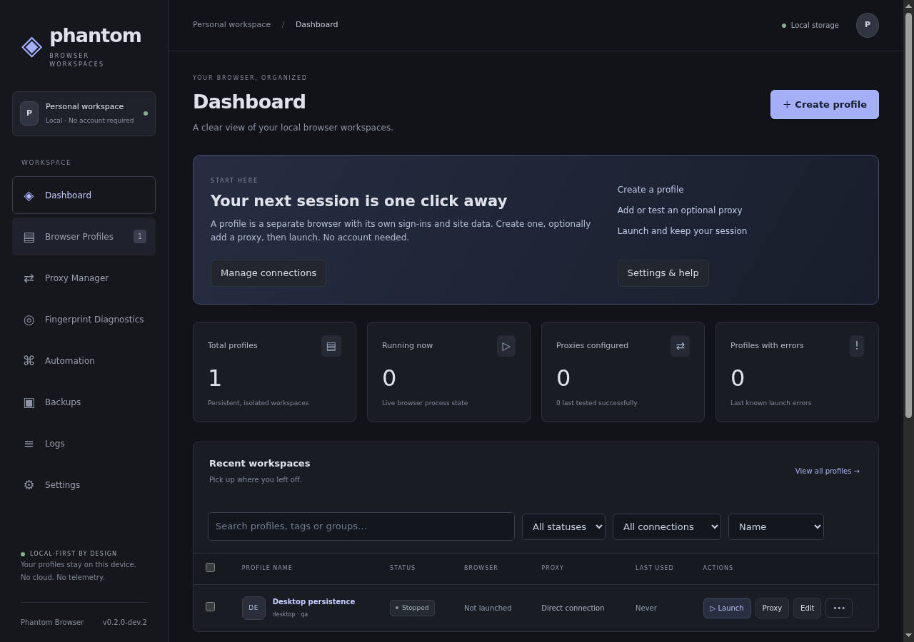
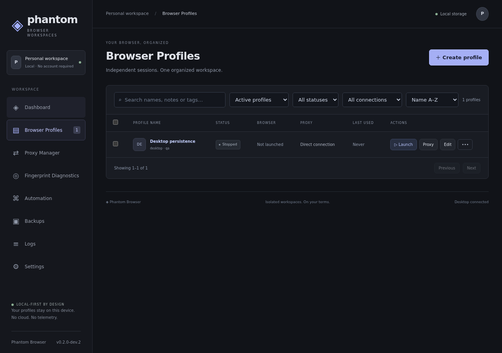

> **Fresh master-upgrade stage:** new local source `9c0e9b3` passes Linux unit/browser/Electron tests, but **has not been pushed or validated on fresh Windows CI** (Git authentication unavailable). See [current report](docs/MASTER_UPGRADE_REPORT.md). Remains development-only; the pinned browser also needs a reviewed security-patch update. Older green CI/installer evidence below applies only to its recorded source.

> **Unreleased remediation candidate: 0.2.0-dev.2.** New screenshot privacy, durable-write rollback, fingerprint observation and recovery fixes are described in [the remediation report](docs/REMEDIATION_REPORT.md). No new release/tag/main merge is authorized. Published v0.2.0-dev.1 report PNGs may contain fixed-position content outside the old DOM mask: treat old reports as sensitive.

# Phantom Browser — local Windows browser workspaces

Free, local-first Electron + React + SQLite + Playwright Chromium profile manager. No account, cloud service, paid API or telemetry. **Not a stealth/anonymity product or an independently audited security tool.**

**Published release:** [v0.1.1 Windows x64 setup](https://github.com/emmanuellaisa00/phantom-browser/releases/download/v0.1.1/Phantom-Browser-Setup-0.1.1-x64.exe), SHA256 `5a6bd724842998cda204b8c7d75e2dc19140bd13d63c9a911fb811cab764cdc8`. The installer is unsigned. v0.1.0 remains untouched.

**Development prerelease:** [v0.2.0-dev.1 Windows x64 setup](https://github.com/emmanuellaisa00/phantom-browser/releases/download/v0.2.0-dev.1/Phantom-Browser-Setup-0.2.0-dev.1-x64.exe). Published after [Linux and Windows Server 2025 CI passed](https://github.com/emmanuellaisa00/phantom-browser/actions/runs/40507389557), including DPAPI, the actual installer and installed-runtime tamper/repair. SHA256 `7b03512149e1ee4bcdc2291f9426c8ae71ddea7fc0157aa6c04953fda34ab68e`. **Unsigned development prerelease, not production-approved.** Manual consumer Windows 10/11 upgrade/uninstall checks remain pending. v0.1.1 remains latest stable; no main merge. See [implementation/evidence](docs/V02_IMPLEMENTATION.md).




The [40-image gallery](docs/screenshots/README.md) is historical v0.1.1 UI evidence with synthetic data, including clearly labelled Linux native dialogs. It does not show every new development control.

## Implemented capabilities

- Real independent persistent Chromium directories; simultaneous profiles subject to a configurable resource limit. Cookies, local storage, IndexedDB and Chromium history are tested for persistence/isolation.
- Create/edit/duplicate/delete, descriptions/notes/tags, search/status/archive filters, sort/pagination, guarded sequential bulk requests, archive/unarchive without removing data, session-activity timestamps.
- Four-step guided creation/editor. Startup URL lists, homepage action, legacy launch URL compatibility, opt-in native tab/session restoration. No profiles auto-launch on application startup.
- Per-profile HTTP/HTTPS proxy configuration; protected credentials using Windows DPAPI only. Local real-browser tests verify HTTP Basic and unauthenticated SOCKS5 routing, concurrent isolation and failure without direct fallback. **HTTPS proxy transport and real provider/DNS/WebRTC leak behavior require further verification.** SOCKS5 authentication is rejected.
- Explicit proxy probe using api.ipify.org, or controlled local endpoints in tests. Whole-operation latency, redacted errors and user-entered region labels; no automatic location matching.
- Stable native Playwright preferences: viewport/screen, locale/timezone, color/motion, DPR, optional native-OS Chromium UA, explicit geolocation consent and documented Chromium WebRTC policy. Diagnostics expose observed values and limitations. No canvas/audio/font/hardware/WebGL spoofing, mobile emulation or undetectability claims.
- Structured local automation: navigation, current title/URL reads, delay, selector/state waits, exact-URL/title conditions, click, fill, fully opaque screenshot derivative, cancellation. Reports have run IDs, start/end timestamps, per-step/total duration and safe outcomes. **Raw read results/criteria/inputs are intentionally omitted; new screenshots are opaque derivatives with no retained source pixels.** No general JS/shell/network automation endpoint.
- Compatible bounded gzip backup/restore plus recommended authenticated password-encrypted **compact JWE**, implemented by pinned `jose` over WebCrypto. Encryption uses PBES2-HS512+A256KW, 310,000 iterations and A256GCM. Restore authenticates before decompression or profile creation. No password recovery. Exported proxy credentials/assignments are excluded; browser cookies may remain Windows-account-bound.
- Sandboxed, isolated Electron renderer with strict validated/authorized IPC. Pinned runtime archive/per-file verification and conservative ownership-aware locks remain in place.

See [fingerprint capabilities](docs/FINGERPRINT_CAPABILITIES.md), [proxy limits](docs/PROXY_LIMITATIONS.md), [backup/restore](docs/BACKUP_RESTORE.md), [troubleshooting](docs/TROUBLESHOOTING.md), [security boundaries](SECURITY.md), [audit](docs/V02_AUDIT.md), [comparison and verification](docs/V02_IMPLEMENTATION.md), [Windows installation](docs/WINDOWS_INSTALL.md) and [changelog](CHANGELOG.md).

## Development

Node **24.22.0** (`>=24.22.0 <25`), Electron **45.0.0**, Playwright **1.64.1**, bundled Chromium **156.0.8078.4** revision **1248**. Windows x64 is the installation target; Linux is used for development/CI. macOS runtime provisioning is not supplied.

```sh
git clone https://github.com/emmanuellaisa00/phantom-browser.git
cd phantom-browser
# Select the development branch after it has been pushed, or import its supplied Git bundle.
npm ci
npm run provision
npm run verify:runtime
npm run build
npm start
# or: npm run dev
```

On Linux, `npx playwright install-deps chromium` plus GTK3 and Xvfb are needed for headless/Electron validation. Production credential protection intentionally fails closed outside Windows.

| Command | Purpose |
|---|---|
| `npm run typecheck` / `npm run lint` | Strict TypeScript / ESLint |
| `npm test` | Unit and runtime regression suites |
| `npm run test:runtime` | Runtime/archive verifier tests |
| `npm run test:integration` | Real persistent Chromium and local proxy tests |
| `npm run build` | Typecheck, Vite renderer, esbuild main/preload |
| `npm run test:desktop` | Actual Electron, preload, IPC, CRUD, security and new wizard/encrypted-backup round trip |
| `npm run test:installed` | Windows installed-EXE/runtime-tamper test; requires `PHANTOM_INSTALLED_EXE` |
| `npm run dist:win` | Windows-only verification gate + NSIS build; publication disabled |
| `npm run licenses` / `npm audit` | Dependency notices / advisory check (neither is a full security audit) |

Provisioning never generates trusted hashes from the current download. Trust pins/manifests are reviewed source data, not a signature or protection against an attacker who can replace the application and its pins. See [runtime update/rollback procedure](docs/RUNTIME_UPDATES.md).

## Data and upgrades

Profiles live under Electron's user-data directory, separate from installation files. Archive does not delete data; delete requires native confirmation; uninstall is configured to retain app data. Browser process crashes and uncertain ownership retain locks rather than killing an arbitrary PID.

**Back up the entire user-data directory while stopped before trying this branch.** v0.1.1 metadata loads with additive defaults, without dropping tables or files. Once the new app saves extended JSON fields, the old strict v0.1.1 application may not read it. App downgrade is **not** automatically safe: use a separate pre-upgrade directory backup. Never run two versions against the same data concurrently. Manual Windows 10/11 install/upgrade/uninstall checks and a valid code signature remain release gates.

## Beginner workflows

Start with the [first-session guide](docs/BEGINNER_GUIDE.md) for the guided wizard, proxy import/test/assignment, profile details, session safety and real desktop screenshots. See [UX verification and limitations](docs/UX_IMPLEMENTATION_REPORT.md) for measured results and delivery status.
